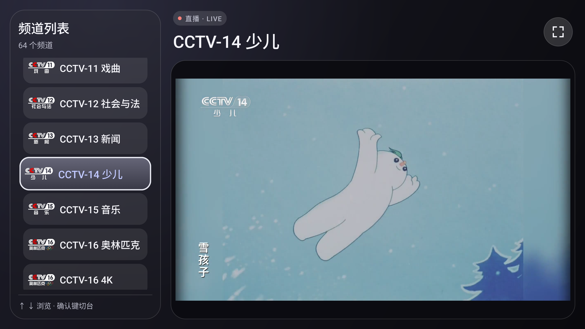

# TV Box


TV Box 是一款用 Kotlin 开发的电视直播应用，支持 Android TV、电视盒子和横屏手机。应用内置 64 个频道，支持遥控器和触屏切台，可全屏观看，并会记住上次播放的频道。

## 播放界面



## 使用

- 遥控器按上下键浏览频道，按确认键切台。白色描边表示遥控器焦点，淡紫色频道名表示当前频道。
- 按右键移到全屏图标，按确认键进入全屏。全屏时按返回键或确认键回到列表。
- 触屏可以点按频道切台，也可以点按全屏图标或画面切换全屏。视频按默认比例显示。

## 直播与兼容性

取源逻辑参考 `ysp-live-main`，已移植到 Kotlin。应用直连央视频上游，使用 JCE 主线路和 BK 备用线路，无需 Python 或单独部署服务。

频道目录随 APK 打包。播放时持续刷新当前频道的 HLS 清单，切台或应用进入后台时关闭旧取源会话。播放器通过设备内的回环地址读取清单，视频分片直接从 CDN 获取。直播延时取决于上游分片和播放器缓冲。

最低支持 Android 5.0（API 21）。Android 5.x 使用 LibVLC，Android 6.0 及以上优先使用 Media3，播放失败时可回退到 LibVLC。已在 Android 5.0.2 和 Android 17 的 ARM64 模拟器上验证起播、切台和全屏操作。

## 构建与安装

准备 JDK 17 和 Android SDK Platform 34。用 Android Studio 打开项目并同步 Gradle，或在项目根目录执行以下命令。

```bash
./gradlew :app:assembleDebug
```

在 Windows PowerShell 中使用项目自带的批处理脚本。

```powershell
.\gradlew.bat :app:assembleDebug
```

调试 APK 输出到 `app/build/outputs/apk/debug/`。按设备 ABI 选一个 APK 安装即可。

| ABI | 调试 APK |
| --- | --- |
| `arm64-v8a` | `app-arm64-v8a-debug.apk` |
| `armeabi-v7a` | `app-armeabi-v7a-debug.apk` |
| `x86` | `app-x86-debug.apk` |
| `x86_64` | `app-x86_64-debug.apk` |

设备已连接 ADB 时，可以用 `adb shell getprop ro.product.cpu.abilist` 查看支持的 ABI。ARM64 设备可用以下命令安装调试包。

```bash
adb install -r app/build/outputs/apk/debug/app-arm64-v8a-debug.apk
```

`./gradlew :app:assembleRelease` 会在 `app/build/outputs/apk/release/` 生成未签名的发布 APK。发布版启用代码和资源压缩，安装前需要用自己的密钥签名。

## 在线更新

从 1.0.0 起，选择播放页右上角的「检查更新」，即可从 GitHub 下载适配本机架构的新版 APK，并在系统安装界面确认更新。遥控器可从频道列表连按两次右键进入该入口。首次安装需要手动操作。Android 8.0 及以上可能会要求先允许 TV Box 安装应用。

发布新版时，在 `app/build.gradle` 递增 `versionCode` 并更新 `versionName`。用同一发布密钥签名各架构的 APK，将它们作为附件上传到 [GitHub Releases](https://github.com/vtsoft-cn/TV-Box/releases) 的正式发布。附件命名为 `tvbox-<versionCode>-<ABI>.apk`。例如，1.0.0 的 ARM64 包命名为 `tvbox-1-arm64-v8a.apk`。同一次发布的 APK 使用相同版本号。应用使用 GitHub 提供的 SHA-256 校验值，并检查 APK 的包名、版本号及签名。此前安装了不同签名的 APK（例如调试包）的设备，需要卸载旧版后再安装正式版。

## 代码入口

- [频道目录](app/src/main/res/raw/ysp_channels.tsv)包含频道名称、上游 ID 和请求清晰度。
- [YspProtocol.kt](app/src/main/java/com/example/tvbox/YspProtocol.kt)负责 JCE 和 BK 取源请求。
- [YspLiveSource.kt](app/src/main/java/com/example/tvbox/YspLiveSource.kt)负责直播清单刷新和备用 CDN 检查。
- [MainActivity.kt](app/src/main/java/com/example/tvbox/MainActivity.kt)负责播放器选择、重试和全屏。

## 许可证

本项目采用 MIT 许可证。详见 [LICENSE](LICENSE)。
